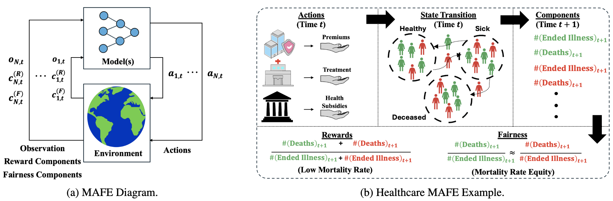

# MAFE: Multi-Agent Fair Environments for Decision-Making Systems

**Published at ICML 2026**



## Description

This repository contains the code for the Loan, Healthcare, and Education MAFEs discussed in our paper:

**MAFE: Multi-Agent Fair Environments for Decision-Making Systems**  
Published at **ICML 2026**.

## Requirements

Below is a list of the libraries and Python version used to develop this code.

- torch 2.2.2  
- python 3.8.6  
- seaborn  
- matplotlib  
- numpy  
- pandas  
- scipy  
- sklearn

## Training on a MAFE

All training code is contained within the `main.py` file of the respective MAFE. To view options, run:

```bash
python main.py --help
```

For example, run the following command for the Education MAFE:

```bash
python main.py "Education_Environment"
```

## Citation

If you use this work in your research, please cite our paper:

```bibtex
@InProceedings{pmlr-v306-lazri26a,
  title = 	 {{MAFE}: Enabling Equitable Algorithm Design in Multi-Agent Multi-Stage Decision-Making Systems},
  author =       {Lazri, Zachary Mcbride and Nakra, Anirudh and Brugere, Ivan and Dervovic, Danial and Polychroniadou, Antigoni and Huang, Furong and Dachman-Soled, Dana and Wu, Min},
  booktitle = 	 {Proceedings of the 43rd International Conference on Machine Learning 2026},
  publisher =    {PMLR}
```
